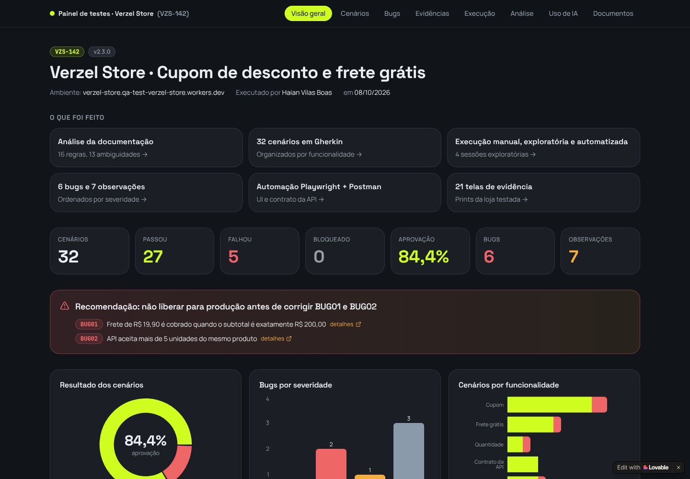

# Verzel Store · Teste técnico de QA

Validação da entrega **VZS-142 · cupom de desconto + frete grátis** da Verzel Store, feita como teste técnico para a vaga de QA Júnior na Verzel.

| | |
|---|---|
| **Loja** | https://verzel-store.qa-test-verzel-store.workers.dev/ |
| **Documentação da entrega** | https://verzel-store.qa-test-verzel-store.workers.dev/documentacao |
| **API** | https://verzel-store.qa-test-verzel-store.workers.dev/api |
| **Painel de resultados** | **https://verzel-store-qa-painel.lovable.app** |
| **Autor** | Haian Vilas Boas · [LinkedIn](https://www.linkedin.com/in/haian-vilas-boas-806647221) · [GitHub](https://github.com/Dev-Haian) |

## 📊 Painel de resultados: comece por aqui

### 👉 **[verzel-store-qa-painel.lovable.app](https://verzel-store-qa-painel.lovable.app)**

**Todas as informações deste teste estão no painel**, em uma só tela e sem precisar abrir arquivo por arquivo:

- **Visão geral:** números da execução, taxa de aprovação, recomendação de liberação e gráficos por resultado, severidade e funcionalidade.
- **Cenários:** os 32 cenários em abas por funcionalidade, com o Gherkin de cada um, resultado, regra coberta, camada (UI/API), tipo de execução e evidências.
- **Bugs:** os 6 bugs por severidade, com a regra violada, os prints e o link para o report completo, além das 7 observações.
- **Evidências:** galeria com as 21 telas da loja capturadas durante os testes.
- **Execução, Análise e Uso de IA:** sessões exploratórias, tela × API, regras, ambiguidades e onde a IA foi usada.
- **Documentos:** todos os documentos do repositório, renderizados dentro do painel.
- **Automação:** resultados do Playwright (interface) e do Postman/Newman (API).

[](https://verzel-store-qa-painel.lovable.app)

O painel foi feito com o **Lovable** e serve só para exibir os resultados. Ele lê os dados direto deste repositório ([docs/resultados.json](docs/resultados.json)) e os prints de [docs/evidencias/](docs/evidencias/). Qualquer atualização feita aqui aparece lá automaticamente. Os documentos abaixo trazem o mesmo conteúdo com o detalhamento completo.

## Resumo da execução

| Cenários | ✅ Passou | ❌ Falhou | ⛔ Bloqueado | Bugs (crítico / alto / médio / baixo) |
|---|---|---|---|---|
| 32 | 27 | 5 | 0 | 0 / 2 / 1 / 3 |

**Recomendação: a entrega não deve ir para produção antes da correção dos dois bugs de severidade alta.**

- **[BUG01](docs/04-bugs.md#bug01):** o frete de R$ 19,90 é cobrado quando o subtotal é **exatamente R$ 200,00**. A regra diz "a partir de R$ 200,00, inclusive". O erro está na API e chega ao pedido.
- **[BUG02](docs/04-bugs.md#bug02):** a API aceita **mais de 5 unidades** por produto, e o pedido é confirmado. A tela bloqueia, mas a regra vale também para a API.

O restante do cupom e do frete está correto nas duas camadas: desconto sobre o subtotal, maiúsculas e espaços, cupom inválido e expirado, um cupom por vez, frete calculado antes do desconto, desconto fora do frete, arredondamento e os valores da tela iguais aos da API. Também foram encontrados 4 bugs de severidade média e baixa e 7 observações.

## Onde encontrar cada entrega

| Entrega pedida | Arquivo |
|---|---|
| **Painel com todos os resultados** | **https://verzel-store-qa-painel.lovable.app** |
| Análise da documentação, premissas e ambiguidades | [docs/01-analise-da-documentacao.md](docs/01-analise-da-documentacao.md) |
| Cenários de teste (Gherkin) | [docs/02-cenarios.feature](docs/02-cenarios.feature) |
| Execução dos testes manuais e exploratórios, com resultados | [docs/03-execucao.md](docs/03-execucao.md) |
| Report dos bugs encontrados | [docs/04-bugs.md](docs/04-bugs.md) |
| Evidências da execução | [docs/evidencias/](docs/evidencias/): prints da interface em `ui/` e relatório da API em `api/relatorio-newman.html` |
| Automação da interface (Playwright) | [tests/ui/](tests/ui/) |
| Automação da API (Postman) | [postman/](postman/) |
| Resultados em formato estruturado | [docs/resultados.json](docs/resultados.json) |
| Uso de IA | [docs/05-uso-de-ia.md](docs/05-uso-de-ia.md) |

## Como rodar a automação

Pré-requisitos: **Node.js 18+** e Git.

```bash
git clone https://github.com/Dev-Haian/verzel-store-qa.git
cd verzel-store-qa
npm install
npx playwright install chromium

npm test                 # interface (Playwright) e depois API (Newman)
npm run test:ui          # só a interface
npm run test:api         # só a API (collection do Postman via Newman)
npm run test:headed      # interface com o navegador aberto
npm run report           # abre o relatório HTML do Playwright
npm run evidencias       # roda a interface e salva os prints em docs/evidencias/ui
```

O relatório da API fica em `reports/newman.html` depois do `npm run test:api`.

### No Postman

1. Importe `postman/verzel-store.postman_collection.json` e `postman/verzel-store.postman_environment.json`.
2. Selecione o environment **Verzel Store · QA**.
3. Rode a collection pelo **Collection Runner**.

Cada requisição tem o ID do cenário (`CTxx`) no nome.

### Resultado esperado da automação

| Suíte | Total | Resultado |
|---|---|---|
| Playwright (interface) | 17 testes | 16 passam e 1 **falha esperada** (`test.fail`) que documenta o BUG01. Se o bug for corrigido, o teste passa a acusar e a marcação deve ser retirada. |
| Postman/Newman (API) | 46 requisições · 272 asserções | 39 passam. As 7 que falham são as marcadas com `[BUG01]`, `[BUG02]`, `[BUG04]` e `[BUG05]` no nome: elas falham **porque os bugs existem**. |

### Trocar a URL da loja

```bash
BASE_URL=https://outra-url npm run test:ui
npx newman run postman/verzel-store.postman_collection.json --env-var baseUrl=https://outra-url
```

### CI

Os testes rodam no **GitHub Actions** a cada push ([.github/workflows/playwright.yml](.github/workflows/playwright.yml)). Os relatórios do Playwright e do Newman ficam disponíveis como artefatos da execução. O passo da API não derruba o pipeline enquanto os bugs conhecidos estiverem abertos.

### Estrutura

```
├── docs/
│   ├── 01-analise-da-documentacao.md   ← regras, API, ambiguidades e estratégia
│   ├── 02-cenarios.feature             ← 32 cenários em Gherkin com rastreabilidade
│   ├── 03-execucao.md                  ← resultado por cenário, sessões exploratórias, tela × API
│   ├── 04-bugs.md                      ← 6 bugs e 7 observações
│   ├── 05-uso-de-ia.md
│   ├── resultados.json                 ← mesmos resultados em JSON
│   └── evidencias/                     ← prints (ui/) e relatório Newman (api/)
├── tests/ui/                           ← Playwright + TypeScript
│   └── support/loja.ts                 ← page object da loja
├── postman/                            ← collection e environment
├── playwright.config.ts
└── .github/workflows/                  ← CI
```

## Fora do escopo

Conforme as regras do teste, **não** foram feitos testes de carga, estresse ou segurança, porque o ambiente é compartilhado com outros candidatos. As chamadas automáticas usam intervalo entre requisições e no máximo 2 navegadores em paralelo.
